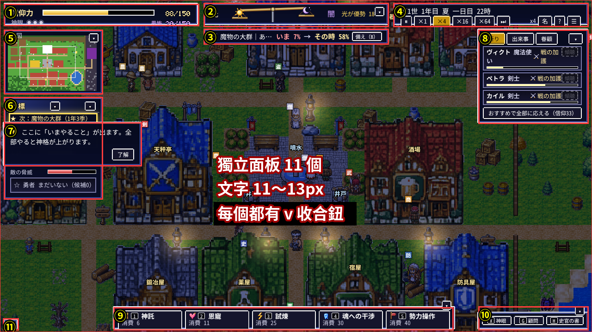
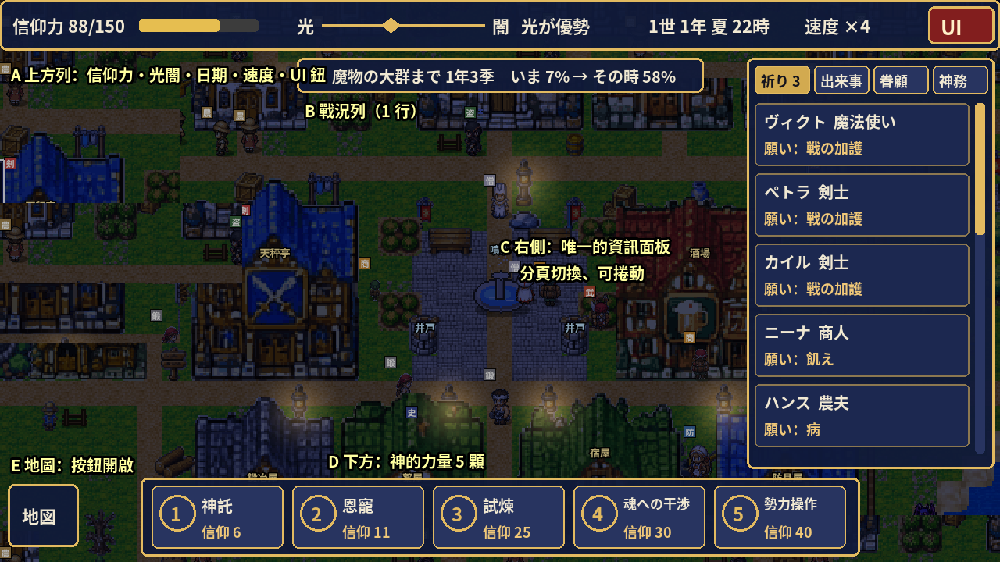
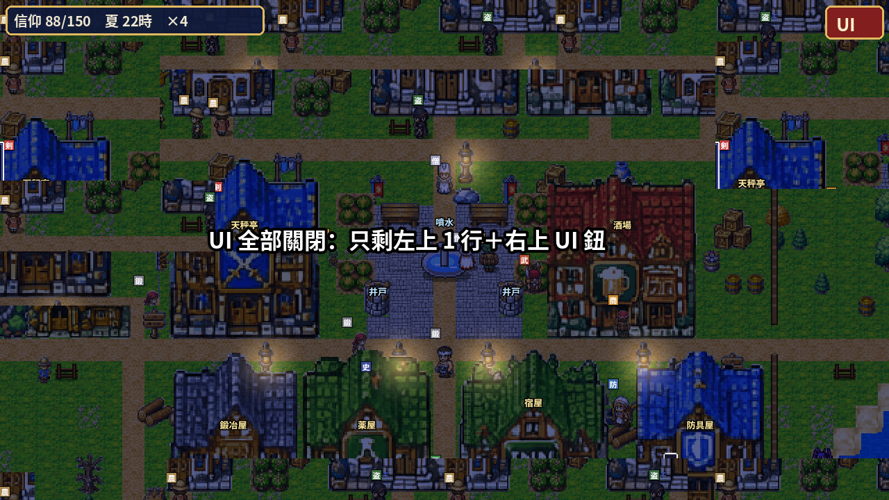

# 《輪迴之天秤》遊戲中 UI 改版提案（v5・給美術）

> 2026-11-25　撰寫：Claude（SEVEN 指示：下一個階段做，先提案給美術）
> 範圍：**遊戲進行中**的畫面（HUD、面板、按鈕、視窗）。開頭畫面已有提案圖，不在本文件。
> 美術依本文件設計 → Claude 檢查 → SEVEN 決定 → Codex 實作。

---

## 1. 現在的問題（SEVEN 試玩回饋＋Claude 檢查）

| # | 問題 | 說明 |
| --- | --- | --- |
| 1 | **字太小** | 畫面上的字大多是 11～13px（Claude 實測：11px 20 處、13px 36 處，16px 只有 3 處）。在一般螢幕上幾乎看不清楚 |
| 2 | **看不懂是什麼** | 「神眼 ●●●」「畏怖 20/150」「光が優勢 18」等，只有數字和縮寫，沒有說明；圖示也太小 |
| 3 | **面板太多、太零碎** | 畫面上同時有 **11 個獨立面板**（上方 4、左邊 3、右邊 1、下方 2、左下 1），把地圖切得很碎 |
| 4 | **每個面板都能各自收合，方向亂** | 每個面板都有 ▼ 鈕，有的往上收、有的往下收、有的往左收，玩家不知道按了會怎樣 |
| 5 | **模糊** | 面板外框和圖示是小圖放大顯示，邊緣糊糊的 |
| 6 | **文字擠出外框** | 例：右側「戦の加護」被切成兩行、畏怖數字和神眼重疊、提示泡泡蓋住「目標」 |
| 7 | **不美觀** | 細線框＋深藍底的通用樣式，和開頭畫面（金框、彩繪玻璃）的世界觀不一致 |

---

## 2. 改版方針

### 2-1. 只有一個開關：UI 全部打開／全部關閉
- **刪除所有面板的個別收合鈕（▼）。**
- 右上角放一顆 **「UI」按鈕**（快捷鍵 `Tab`），只有 2 種狀態：
  - **打開**：顯示全部 UI（見 §2-3）。
  - **關閉**：只留左上 1 行（信仰力、季節時間、速度）＋右上的 UI 鈕，其他全部隱藏，**整個畫面都是地圖**。
- 關閉狀態下，有新祈禱或魔物來襲時，UI 鈕會閃爍，並在畫面中央上方跳出 1 行通知（3 秒後消失），不會自動打開 UI。

| UI 打開 | UI 關閉 |
| --- | --- |
|  |  |

（上圖只是**版面配置的示意**，外觀、配色、裝飾請美術自由設計。）

### 2-2. 字要大、要清楚
| 用途 | 大小（1280×720 畫面上） |
| --- | --- |
| 面板標題、分頁 | 22px |
| 一般文字（名字、按鈕） | **20px** |
| 補充文字（費用、說明） | **最小 18px**（不可以小於這個） |
| 大數字（信仰力、勝率） | 24～28px |

- 字型：日文 Noto Sans JP、繁中 Noto Sans TC（標題可以用 Noto Serif 的粗體）。
- 文字要有深色描邊或陰影，在地圖上也看得清楚。
- **不用縮寫**：「神眼」「畏怖」這類詞旁邊加圖示，滑鼠移上去出現 1 句說明。

### 2-3. 面板從 11 個減到 5 個區塊
| 區塊 | 位置 | 內容 | 目前對應 |
| --- | --- | --- | --- |
| **A 上方列** | 畫面最上方，高 64 | 信仰力（數字＋條）、光闇天秤、世・年・季節・時間、速度、UI 鈕、選單鈕 | 現在的 ①②④ 合併 |
| **B 戰況列** | A 的下方中央，1 行 | 下一場戰鬥、剩餘時間、「いま → その時」勝率、備戰鈕 | ③ |
| **C 右側面板** | 畫面右側，寬約 320 | **唯一的資訊面板**。分頁：祈り／出来事／眷顧／神務（原本的「目標」移到這裡）。內容可以捲動 | ⑥⑧ 合併，⑦ 的提示改成面板裡的一行 |
| **D 下方列** | 畫面下方中央，高 100 | 神的 5 種力量（大按鈕：圖示＋名稱＋費用＋快捷鍵） | ⑨ |
| **E 地圖鈕** | 左下角 | 按了才打開小地圖（大視窗，可以點地圖移動鏡頭），再按一次關閉 | ⑤ |

- 原本 ⑩（神眼、顧問、史官の書）移到 A 上方列右側的「選單」裡。⑪ 刪除。
- 面板**不可以重疊**，也不可以蓋住畫面正中央（地圖中心 640×400 範圍保持空白）。
- 提示泡泡（新手教學）要指向對象，但不能蓋住其他面板。

### 2-4. 清楚、不模糊
- UI 素材以 **1280×720 的原寸**交付，**不放大顯示**。
- 外框、按鈕用九宮格（四角不變形），交付格式和開頭畫面相同。

---

## 3. 視覺方向（給美術的參考，最後由美術決定）
- **和開頭畫面統一**：深藍底＋金色外框，搭配彩繪玻璃、羊皮紙的質感。開頭畫面的提案圖（`docs/figures/v41b/seven_title_proposal.png`）是最好的參考。
- 「神在高處俯瞰」的感覺：上方列可以像神殿的橫樑；右側面板可以像一本攤開的書、或神殿的石板。
- 神的 5 種力量要有**各自的顏色和圖示**，一眼分得出來（例：神託＝白光、恩寵＝粉紅愛心、試煉＝紫色閃電、魂への干渉＝藍色靈魂、勢力操作＝紅旗）。
- 注意：遊戲世界是 16bit 點陣，UI 可以比較細緻，但風格要搭，不要太現代（不要扁平化、霓虹感）。

---

## 4. 請美術交付的素材

| # | 素材 | 狀態／數量 |
| --- | --- | --- |
| 1 | 上方列底板（A） | 1 張（可九宮格） |
| 2 | 戰況列底板（B） | 一般、危險（勝率 < 30%，紅色）2 種 |
| 3 | 右側面板外框（C） | 1 張（九宮格） |
| 4 | 分頁按鈕 | 一般、選中、有新通知（紅點）3 種 |
| 5 | 清單卡片（祈禱、事件、眷顧者） | 一般、滑鼠移上去、選中、緊急（紅邊）4 種 |
| 6 | 捲軸 | 軌道、把手 |
| 7 | 力量按鈕（D） | 5 種力量 × 一般／滑鼠移上去／選中／信仰不足（灰）4 種 |
| 8 | 力量圖示 | 5 個（64×64、32×32） |
| 9 | 小圖示 | 信仰力、神眼、畏怖、光、闇、季節 4 種、速度、UI、選單、地圖、警告、勇者，約 16 個（32×32） |
| 10 | UI 開關鈕 | 打開、關閉、閃爍（有通知）3 種 |
| 11 | 小地圖視窗外框（E） | 1 張 |
| 12 | 通知條（UI 關閉時的 1 行通知） | 1 張 |
| 13 | 提示泡泡（教學） | 外框＋指示箭頭 |
| 14 | 一般視窗（評定會、戰報等） | 外框＋標題列（可以沿用開頭畫面的對話框） |
| 15 | **完成示意圖（mockup）** | UI 打開、UI 關閉、評定會視窗、戰報視窗，各 1 張（1280×720） |

- 交付格式照 `開頭畫面設計指示書_設計部.md` 第 3 部：PNG、manifest、九宮格切割值、命名規則（英文小寫＋底線）。
- **mockup 先交**，Claude 檢查、SEVEN 決定方向後，再做全部素材。

---

## 5. 給 Codex（素材到了之後實作）
- 刪除各面板的收合功能；加上 UI 全開／全關（`Tab`）。
- 依 §2-3 重新排版；字級依 §2-2。
- 驗收：
  - 1280×720 截圖：UI 打開、關閉各 1 張；
  - 畫面上**沒有任何小於 18px 的字**（測試自動檢查）；
  - 面板互不重疊；
  - SEVEN 試玩確認「看得懂、好看」。
