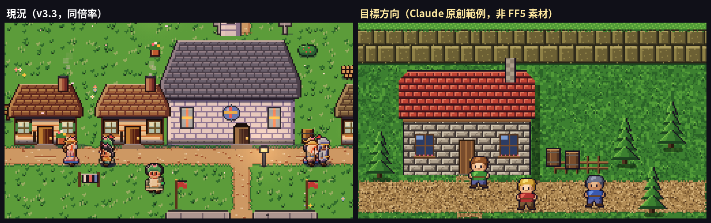
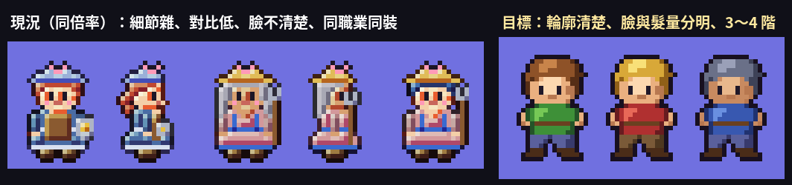
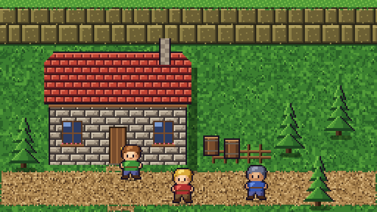
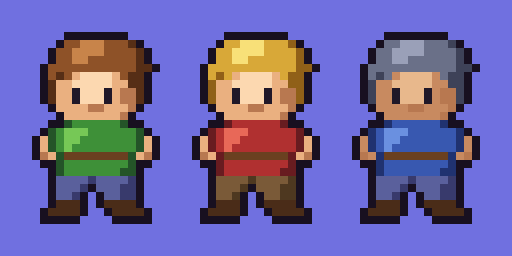

# 《輪迴之天秤》V3.4 點陣精修指示：提升到 SFC《FF5》水準（Codex 專用）

> 版本：V3.4（2026-10-13）　對象：Codex　前提：V3.3（Sprite DSL、`11a`～`11f`、`13a`、`14d`）已上線
> 目標：SEVEN 指定的參考水準是 SFC《FF5》的城鎮畫面與角色點陣（參考連結見 §0.2）。
> 本次只改**視覺與地圖配置**，不改遊戲規則。與 V4（遊戲性）分開提交。
> 交付方式沿用 V3.3：**一次做完才交付 → Claude 預審 → SEVEN 只驗收一次**。

---

## 0. 先讀

### 0.1 先修錯（A0，最優先，約 10 分鐘）
**NPC 左右移動時倒退走**。
- 原因：`src/11c_char.js` 的 `humanSprite()` 中，側面圖（view `'S'`）的圖資是**面向右**畫的，但程式把 dir 2 當成「左」直接使用，dir 3（右）再鏡像。結果左右顛倒。
- 修法：改成 **dir 2 時鏡像、dir 3 不鏡像**；或把所有側面圖資左右翻轉，二選一。
- 測試：新增 `test/facing.js`。對全部職業、男女、小孩、老人，在 dir 2、dir 3 各算一次「膚色像素的 x 重心」，臉必須在前進方向那一側。
- 這項先單獨提交，再開始 §2 以後的工作。

### 0.2 參考圖的使用規則（必讀，有法律風險）
- SEVEN 提供的參考是 SFC《FF5》的城鎮截圖與角色點陣，以及 FF 同人 wiki 的角色點陣頁（https://w.atwiki.jp/fftsukurou/pages/45.html）。**這些都是他人的著作。**
- 參考圖**只用來校準「細膩度、密度、比例、明暗」的水準**。
- **嚴禁**：
  - 描圖、逐點複製、改色再用。
  - 重現特定角色、建築、圖示、配色表。
  - 把參考圖放進 repo。repo 與 GitHub Pages 都是**公開**的。
- 本文附的「目標方向」範例圖，是 Claude 依本規格**原創**的示意，可以直接參考配色與做法，但仍請重新設計，不要整張照搬。

---

## 1. 差距診斷（同倍率比較）




| # | 項目 | 現況（v3.3） | 參考水準 | 差距 |
| --- | --- | --- | --- | --- |
| G1 | **建築比例** | 民宅 3×3 格，牆面約 1 格高；人站在旁邊像玩具屋 | 民宅 5～7 格寬，屋頂 2～3 格、牆面 2 格高；人約 1×1.5 格 | **最大的差距**：建築要放大，正面牆要高 |
| G2 | **草地** | 偏亮、偏平，零星的點和花 | 暗一點，5 階綠色成簇分布，有草叢 | 質感密度不足 |
| G3 | **牆面材質** | 木板線條、淺色 | 石磚或木板逐塊上 3 階，有灰縫、受光邊 | 缺材質感 |
| G4 | **屋頂** | 有瓦線，但對比低 | 瓦片成列、每列有亮邊與陰影；屋脊與屋簷有描邊 | 對比與立體感不足 |
| G5 | **高低差** | 全部平地 | 懸崖、岩壁、階梯、地形段差 | 缺少地形層次 |
| G6 | **樹** | 小圓樹（1 格），像棒棒糖 | 針葉樹 1×2 格，3～4 層枝葉；有落影 | 樹太小、太卡通 |
| G7 | **角色** | 細節多但雜、對比低、臉不清楚；同職業長得一樣（例：8 個劍士同裝） | 輪廓清楚、頭大、髮量大、臉清楚；每個人一眼可分 | 可讀性與多樣性不足 |
| G8 | **整體色調** | 偏粉彩、亮度高、暗部少 | 明度較低、飽和度較高、暗部多，物件之間有陰影 | 需要整體調色 |
| G9 | **密度** | 建築之間大片空草地 | 柵欄、花圃、木桶、樹叢、石頭、菜園很密 | 地圖太空 |
| G10 | **道路** | 邊緣直角、顏色平 | 邊緣不規則、有碎石與車轍、和草地交界有過渡 | 缺過渡 |

---

## 2. 目標方向（Claude 原創範例）




範例的做法如下（產生程式：`docs/figures/v34/mk_target.py`，Python＋PIL，可直接執行）：
- **草地**：5 階綠，以 2×2 像素成簇隨機，再加「V 字草叢」，避免白噪點。
- **石牆**：磚塊 10×5，上下錯位；每塊有亮邊（上、左）、暗邊（下、右）和灰縫。
- **屋頂**：每列 5px，最上 1px 亮、下 2px 暗、最下 1px 接近黑；每 6px 一道瓦縫，上下列錯位。
- **懸崖**：不規則寬度的岩塊，分 2 段；頂端有草緣。
- **針葉樹**：4 層三角形；左亮右暗、每層底部最暗；右緣描邊；地面有橢圓落影。
- **落影**：建築右側 6px、樹與角色腳下橢圓，一律把底色**乘 0.6**，不要蓋純黑半透明。
- **角色**：2.5 頭身。頭部（含頭髮）占 24 行裡的 11 行；頭髮占頭部約 60%；眼睛 1×2 深色；衣服 3 階。

---

## 3. 規格（可量測）

### 3.1 不變的部分
- 格子 16×16、角色 16×24、畫布 640×360 以 CSS 放大 2 倍。
- 碰撞、尋路、模擬邏輯都不改。§3.4 的建築重新配置例外，但必須通過所有測試。
- 規則 1 不變：無外部素材，全部由程式生成（沿用 Sprite DSL）。

### 3.2 色彩
- 每個材質一組 **5 色色階**：外框色＋暗＋中＋亮＋高光。暗部偏冷、亮部偏暖（hue shift）。
- 草地、道路、石、木、屋頂各一組，範例色票見附錄 A。
- 整體亮度比 v3.3 **降低約 10～15%**，飽和度提高約 10%。
- 每個角色 ≤ 16 色，含外框。

### 3.3 地面
- 草地：5 階、2×2 成簇，草叢密度每格平均 1～2 個。
- 道路：邊緣不規則（隨機凹凸 1～2px），有碎石與明暗；道路和草地交界用 autotile 的邊角圖塊。
- 廣場石板：每塊石頭有亮邊與暗邊，縫線有深淺變化。
- 田地：作物成行，每株作物 2～3 階，隨季節變化。

### 3.4 建築（G1，最重要）
- **新尺寸**：

  | 種類 | 現況 | 新尺寸（寬×高，格） | 組成 |
  | --- | --- | --- | --- |
  | 民宅 | 3×3 | **5×4** | 屋頂 2 列＋牆 2 列 |
  | 商店類（武器、防具、道具、藥局、鐵匠） | 4×4～5×4 | **6×4** | 屋頂 2＋牆 2，掛招牌 |
  | 酒館、旅館、公會 | 5×4～6×4 | **7×5** | 屋頂 2～3＋牆 2～3，有 2 樓窗 |
  | 教會 | 6×5 | **7×6＋尖塔 1×2** | 彩窗、大門 |
  | 魔王城 | 5×6 | 7×8 | 維持暗色系 |

- 地圖 64×40 放得下，但要**重新配置小鎮**（`src/03_world.js` 的 `buildWorld()`）。
  - 門的位置、接道路的格子要重算。
  - 民宅數量可從 12 棟減為 8～10 棟，避免太擠；居民的家可以共用。
- 牆面：石磚或木板逐塊 3 階＋灰縫；窗有窗框、窗格與玻璃反光；門有門框和把手。
- 屋頂：依 §2 的瓦片規則；屋脊與屋簷 1px 描邊；煙囪有磚紋。
- 落影：建築右側 6px（底色 ×0.6）。

### 3.5 地形高低差（G5）
- 地圖北緣（y 0～3）改成**懸崖帶**：2 段岩壁＋頂端草緣。
- 東側魔王領（x ≥ 56）的邊界也改成懸崖或岩壁，入口留一條有階梯的道路。
- 岩壁不可通行，用現有的阻擋機制即可。

### 3.6 樹與小物件（G6、G9）
- 樹 3 種：
  - 針葉 16×32。
  - 闊葉 24×24 或 32×32，3 層樹冠。
  - 灌木 16×16。
  - 全部有落影，冬季有積雪。
- 小物件至少 20 種：柵欄（直、橫、轉角）、花圃、木桶、木箱、石頭、草堆、井、晾衣架、告示牌、菜園等。
- **密度目標**：小鎮範圍內，每 8×8 格至少 4 個物件或樹，但不可擋住道路與門。

### 3.7 角色（G7）
- **頭身比 2.5**：頭（含頭髮）占 11/24 行，身體占 13/24 行。
- 臉：膚色 3 階；眼睛 1×2 深色，要清楚。可加 1px 高光，但**不要做大眼睛**。
- 頭髮：占頭部約 60%；3 階；髮型輪廓至少 8 種，而且一眼可分。
- 衣服：3 階＋外框；腰帶或衣襬至少 1 個細節。
- **多樣性**：同一職業至少要有 3 種配色或裝備變化（例：劍士有鎖甲、皮甲、披風）。男女體型要有差異。同畫面裡，同職業同性別的人看起來不可完全相同。
- 動作沿用 V3.3：4 方向 × 4 幀走路、待機、攻擊、祈禱、受傷。

### 3.8 光影與調色（G8）
- 光源統一在左上。所有落影都在右下，用**乘算**（×0.6）。
- 晝夜沿用 V3.3 的多段色調，套到新圖之後要重新校色。

---

## 4. 交付與驗收

### 4.1 Codex 交付前自我檢查
1. `test/facing.js`（A0）通過；smoke、lang、soak、batch3、story_check、reader_check、drag、visual_pack 全過。
2. 效能：啟動 ≤ 1.5 秒；36 人＋魔物時維持 60fps。
3. 產出 `test/out/visual/v34/`：
   - **同倍率前後比較**（v3.3 vs v3.4），各 1 張：小鎮中心、教會一帶、農場、廣場、懸崖。
   - 角色總覽：全職業 × 男女 × 3 變化 × 4 方向。
   - 建築總覽（白天＋夜晚）、樹與小物件總覽。
4. 自我評分表：§1 的 G1～G10 逐項附截圖，說明改善了什麼。

### 4.2 驗收
- **Claude 預審**：對照本文的目標方向與 §3 規格，不合格就退回。
- **SEVEN 驗收一次**：「點陣細膩度接近 SFC《FF5》」≥ 4/5。
- **法律確認**：Claude 抽查是否有任何圖塊與參考圖過度相似（構圖、配色、特定角色），有就重畫。

---

## 5. 不做

- 不複製、不描摹任何參考圖；不引入外部圖檔或字型。
- 不改模擬邏輯與遊戲規則（V4 另案）。
- 不改畫面解析度與 UI 版面（UI 的視覺可順便套新色調）。

---

## 附錄 A：範例色票（Claude 原創，可沿用或微調）

| 材質 | 外框／最暗 | 暗 | 中 | 亮 | 高光 |
| --- | --- | --- | --- | --- | --- |
| 草地 | #1d4520 | #2b6428 | #3c8030 | #529c38 | #78bc48 |
| 道路（土） | #4e3620 | #71502e | #94703f | #b58f58 | #d6b47c |
| 石牆 | #3a3230 | #6a5e52 | #8c7e6e | #ad9f8b | #d0c4ae |
| 紅屋頂 | #3a1418 | #6a1e22 | #962c28 | #c04434 | #e2745a |
| 木材 | #2a1a0e | #523420 | #784c2c | #a06c3e | #c8945c |
| 懸崖 | #2a2618 | #4a4226 | #6c6034 | #8e8046 | #b0a060 |
| 角色外框 | #181020 | — | — | — | — |

## 附錄 B：角色範例的 Sprite DSL（16×24，Claude 原創）

```
....oooooooo....   o=外框  H/h/k=頭髮 亮/中/暗
...ohhHHHhhhko..   S/s/d=皮膚 亮/中/暗  e=眼
..ohhHHHHhhhhko.   C/c/q=上衣 亮/中/暗  b=腰帶
..ohhHHhhhhhhko.   P/p=褲子 亮/暗  B=靴
.ohhhhhhhhhhhkko
.ohkhsSSSSshkko.
.okssSSSSSsskko.
.oksseSSSesddko.
.oksseSSSesddko.
..ossssddsssdo..
...osssssssdo...
..ooqccccccqoo..
.oqcCCCccccccqo.
osqcCCcccccccqso
osqcCccccccccqso
odsqbbbbbbbbqsdo
.ooqccccccccqoo.
..oqcccccccqqo..
..oPPPPpPPPPpo..
..oPPPpoPPPppo..
..oPPpo.oPPppo..
..oBBBo.oBBBBo..
.oBBBBo..oBBBBo.
.ooooo....ooooo.
```
同一組圖資換色票（附錄 A 的方式）就能做出不同人物；但 §3.7 要求同職業還要有**輪廓**上的差異，不能只換色。
