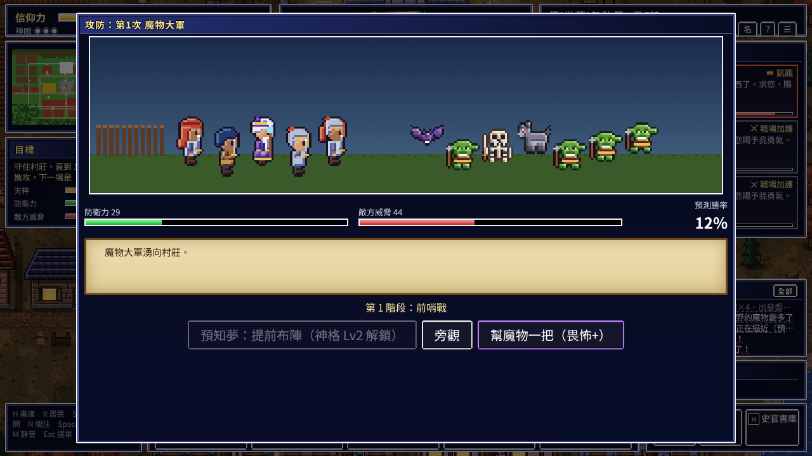
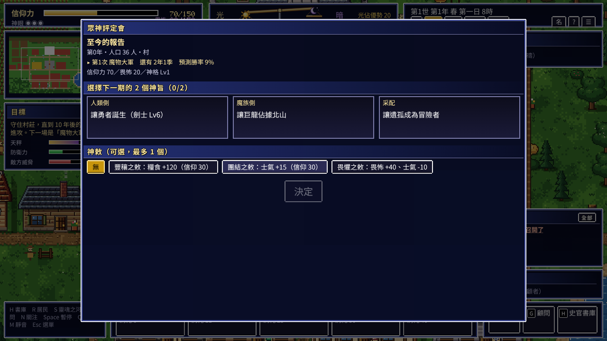
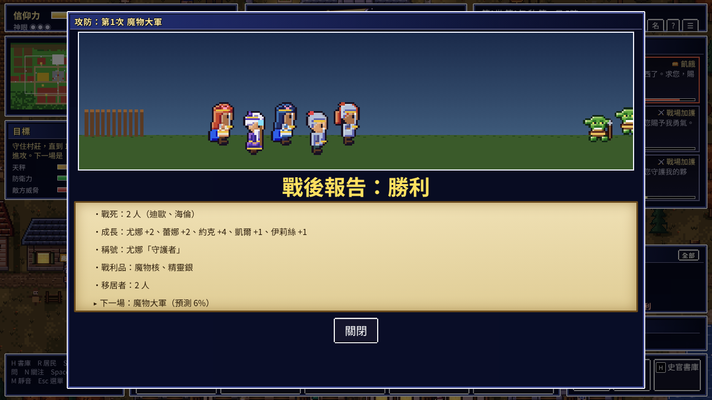

# 《輪迴之天秤》V4.1＋V4.2 開發規格（Codex 專用，合併版）

> 版本：V4.1＋V4.2 合併 r2（2026-10-14，依 SEVEN 回覆更新地圖、信仰收支、遠征）　基準：HEAD `732d656`（V4＋V3.4）
> SEVEN 的決定（2026-10-14）：**V4.1 與 V4.2 放在一起做**。
> V4.2 的決定（SEVEN 2026-10-14 回覆後更新）：
> 1. **地圖**：村莊＋野外做成**一張連續的大地圖**，用拖曳探索（保留拖曳看地圖的樂趣）；**魔王城內部**另做成獨立場景（4 層室內）。
> 2. **魔石可以奉納給教會、變成神的信仰力**。SEVEN 補充：目前祈禱太多、信仰力降太快、沒地方補，這次要一併調整信仰收支（見 A6）。
> 3. **遠征不會削弱魔王，反而會讓魔王軍變強**。重點是讓玩家判斷：提早去可以拿到好處（經驗、道具），代價是魔王軍憤怒、亢奮、變得更強。**沒有提前封印**，封印魔王只能在第 10 年的決戰。
> 4. 遠征失敗時有「俘虜與救援」。
> 5. 順序：V4.1 → W0 → W1 → W2 → W3。
>
> 參考文件（背景與理由）：`docs/V4.1試玩回饋與每日回訪提案.md`（A 部）、`docs/V4.2世界擴張提案.md`。
> 交付方式：**一次做完才交付 → Claude 預審 → SEVEN 只驗收一次**。
> 截圖：`docs/figures/v41/`。

## 施工順序（Codex 內部）
1. **第一部 V4.1**：A12（教學）、A11（勇者）、A1～A5 → A6～A10。
2. **第二部 V4.2**：W0（地圖框架）→ W1（野外）→ W2（道具）→ W3（魔王城與遠征）。
3. 最後再用 V4.2 的內容補完 A12 的「第一次用到時的提示」（野外、遠征），並重跑全部平衡測試。
   - A3 的勝率目標，**要在 V4.2 的狩獵連動加入之後再最終調整**。

---

# 第一部　V4.1：細部調整、勇者標記、教學大改

### A1｜預測勝率不準，而且讓人絕望（最優先）
- **現象**：
  - 開局顯示「預測勝率 9%」，但模擬中「照建議介入」的第 1 次攻防**勝率是 97%**。
  - 實機中，我把第 1 次攻防提前，預測 12%，結果卻「勝利」。
  - 模擬的校準誤差：預測 30% 的實際勝率是 56%，預測 52% 的實際是 80%，**最大誤差 28 個百分點**（規格要求 ≤ 15）。
- **影響**：玩家一開始看到 9% 會以為必輸；看到 12% 卻贏了，之後就不再相信這個數字。整個「備戰讓勝率上升」的目的感就會崩掉。
- **修法**：
  1. **重新校準**：用模擬資料擬合 `winProb()`，讓「預測值」對上「實際戰鬥結果」。驗收：30 局 × 2 策略，每個區間的誤差都 ≤ 15 個百分點。
  2. **顯示兩個數字**：`若現在開戰 9%　→　照目前成長，屆時約 58%`。第二個數字用目前的成長速度推估。這樣開局不會絕望，玩家也知道「放著不管會怎樣」。
  3. **顏色**：< 30% 紅、30～60% 黃、> 60% 綠，並加上箭頭表示趨勢（已有 ▲）。

### A2｜戰鬥中，Lv1 的神幫不了人類
- **現象**：第 1 階段的選項只有「預知夢（Lv2 解鎖）」「旁觀」「幫魔物一把」。剛開局的玩家在**最重要的時刻只能看或幫敵人**。

  
- **修法**：
  - 每個階段從 Lv1 就至少要有**一個幫人類的選項**，用現有的神力和信仰支付，例如：
    - 前哨戰：神諭「布陣」。
    - 主戰：恩寵「加護 1 名冒險者」。
    - 決勝：試煉「激勵英雄」。
  - 神格解鎖的神技，作為**更強的版本**加入。
  - 每個選項顯示「勝率 +x%、花費」，讓玩家看到效果。

### A3｜攻防對認真的玩家太簡單
- **數據**（30 局，照建議介入）：

  | 攻防 | 第 1 次 | 第 2 次 | 巨龍 | 第 3 次 | 魔王 |
  | --- | --- | --- | --- | --- | --- |
  | 勝率 | 97% | 93% | 100% | 90% | 63% |
- **影響**：前 4 場幾乎必勝，緊張感只出現在最後一場，中段變成「例行公事」。
- **修法**：
  - 威脅值隨村莊發展**適度成長**（自適應）。
  - **目標勝率**（照建議介入）：大舉進攻 70～85%、巨龍 60～75%、魔王 55～70%。
  - 不介入：維持第 1 次約 50%、魔王 ≤ 10%（目前是 57% 與 0%，可以）。

### A4｜勇者太早出現（與 A11 一起做）
- **現象**：「劍士 Lv6＝勇者」，實機中**第 0.5 年就出現勇者**。神旨「讓勇者誕生」幾乎不用努力就完成；「勇者誕生」這個 S 級事件也太早用掉了。
- **修法**：
  - 勇者條件改為：Lv8 以上，並且「在攻防中活下來且得到稱號」或「得到神的恩寵 3 次以上」。
  - 目標是勇者在**第 3～6 年**出現。

### A5｜節奏：預設太慢，而且會一直卡在 ×1
- **現象**：
  - 預設速度是 ×1。以 ×1 計算，第 1 次攻防要等**約 20～30 分鐘**。
  - 發生重要事件時會自動降到 ×1（這點很好），但**不會恢復**。實機中，第 25 秒降到 ×1 之後就一直停在 ×1。
- **修法**：
  - 預設改為 **×4**。
  - 自動降速後，玩家關閉通知或過 5 秒，就**恢復原本的速度**。
  - 新增「⏭ 快轉到下一個重要事件」按鈕：以 ×64 跑到下一個 S/A 事件或預兆再停。

### A6｜祈禱堆積與信仰收支
- **現象**：
  - 放著不管 90 秒，祈禱累積了 13 件；約一半會過期。
  - SEVEN 回報：祈禱的人太多，信仰力降太快，沒有地方補充。
- **修法**：
  - 祈禱欄只顯示最緊急的 3 件，加上「還有 n 件」。
  - 新增「依建議回應全部」的批次按鈕，並顯示總花費。
  - 祈禱的生成頻率降約 30%，把份額讓給更有分量的事件。
  - **信仰收支**：
    - 新增穩定的收入來源：W2 的魔石奉納；攻防勝利與神旨達成時的信仰獎勵。
    - 未回應的普通祈禱過期時，**不扣信仰力**（只有緊急祈禱過期才會讓信仰小幅下降）。
    - 驗收：照建議介入時，信仰力不會長期低於 30%，也不會長期卡在上限；以 30 局模擬的信仰力曲線證明。

### A7｜開局畫面太暗
- 遊戲從清晨 6 點開始，畫面是暗的；加上教學的半透明遮罩，第一印象很陰沉。
- **修法**：開局改為上午 9 點。

### A8｜評定會畫面太空、資訊不足
- **現象**：神旨卡只有一行字，沒有寫獎勵、難度、怎麼判定；下半部大片空白；看不到雙方戰力。

  
- **修法**：
  - **神旨卡**：加上「神格經驗 +N」「難度 ★～★★★」「判定方式」「目前進度」。
  - **神勅**：顯示效果與花費，花不起的變灰。
  - **空白處**：放「上一期報告」（大事件 3 條）、「雙方戰力對照」（長條圖），以及下一場的兩個預測數字（A1）。

### A9｜戰後報告缺少「神做了什麼」
- **現象**：報告列出戰死、成長、戰利品，但沒有說神的行動產生了什麼效果。

  
- **修法**：加上幾行，例如：
  - 「你的備戰讓勝率 +18%」。
  - 「恩寵救下了尤娜」。
  - 「神格經驗 +12（Lv2 → 還差 8）」。
  - 「神旨進度：讓遺孤成為冒險者 1/1 ✔」。

  這是**成就感的直接來源**。

### A10｜其他小問題
- `story_check` 仍有 5/60 局 FAIL（多為重複率），沿用 V3.2 B-10 的處理。
- `test/facing.js` 在 Linux 環境啟動失敗，應同 `tut.js` 支援 `CHROME_PATH`。


### A11｜勇者是誰，看不出來（SEVEN 追加）
- **現象**：
  - 目前「劍士 Lv6 以上」就會換成勇者的外觀（藍披風＋金頭冠，`src/11c_char.js` 的 `roleOf()`）。
  - 模擬中，**同時有 3～7 個人長得像勇者**；但「勇者誕生」事件 5 局只出現 1 次。
  - 畫面上沒有任何「這個人是勇者」的標記。玩家搞不清楚誰才是勇者，也不知道勇者有什麼意義。
- **修法**：
  1. **勇者只有一位**（一個世同時最多 1 人），是稱號，不是等級。
     - 條件沿用 A4（Lv8 以上，加上「攻防中活下來並得到稱號」或「得到恩寵 3 次以上」）。
     - 同時符合的人裡，選戰功最高的一位。
     - 由「勇者誕生」S 級事件宣告：自動暫停、鏡頭移過去、短演出、史官寫一章。
  2. **勇者候補**：Lv6 以上的劍士改叫「勇者候補」（最多 3 人），外觀維持一般戰士＋小銀星，**不要用勇者的披風和頭冠**。
  3. **地圖標記**（任何縮放、任何名字顯示設定都要顯示）：
     - 勇者頭上有金色王冠圖示，加上「勇者」兩字。
     - 腳下金色光環（和眷顧者的金環要區分，例如勇者用雙環或閃光）。
     - 候補頭上是小銀星。
  4. **HUD**：在「目標」欄或攻防欄旁邊，常駐一張「**勇者卡**」：
     - 頭像、名字、Lv、稱號。
     - 點擊後鏡頭移到勇者身上。
     - 還沒有勇者時，顯示「勇者：尚未誕生（候補 2 人）」，點擊會列出候補。
  5. **勇者的意義要寫出來**：在勇者卡的提示與教學（A12）中說明——「勇者會在最後的決勝階段對抗敵方首領；勇者越強，決勝越容易贏。」
  6. **勇者死亡**：發出 S 級事件「勇者倒下了」；稱號在一段時間後由候補繼承（「繼承」事件），史官寫一章。
- **驗收**：
  - 30 局模擬中，任何時刻勇者 ≤ 1 人。
  - 截圖：36 人的畫面中，勇者一眼可辨。
  - 勇者卡點擊後鏡頭移到勇者。

### A12｜教學大改：讓小學生也能上手（SEVEN 追加）

**現況診斷**
- 現在的 9 步教學（`src/16_tutorial.js`）是 V3.2 時寫的，只教「祈禱 → 神力 → 史官書庫 → 顧問」。
- **V4 新增的核心玩法完全沒教**：攻防欄、防衛力、備戰（B 鍵）、3 階段攻防、戰後報告、評定會、神旨、神格、畏怖、勇者。
- 所以玩家完成教學後，還是不知道「這一局要做什麼、要怎麼推進」。
- 說明文字偏長、用詞偏難（例：「曲解」「勢力操作」「畏怖」），對小學生太難。

**目標**
一個**小學中年級**（約 9～10 歲）、第一次玩的孩子：
- 不看任何說明書，15 分鐘內能說出：「我是神，要幫村莊打贏魔物。下一場是〇〇，還有〇年。」
- 能自己完成一次「備戰 → 攻防 → 看報告」。

#### A12-1 文字規則（全遊戲適用，教學優先）
- 一句話只講一件事；**中文 ≤ 20 字、日文 ≤ 30 字**；一個畫面最多 2 句。
- 用小學生懂的詞，第一次出現的難詞後面加括號說明，例如：「信仰力（神的能量）」「防衛力（村莊有多強）」「畏怖（魔物對你的害怕）」。
- 日文版：漢字加注音（ruby），設定裡可以關掉。
- 每個指示都配**箭頭與發光框**，指到要按的地方，旁邊寫「點這裡」。

#### A12-2 新教學：「見習神的 3 堂課」（約 10 分鐘，全部用真的操作完成）
在**教學專用的小世界**進行（固定種子、12～18 人、第一次攻防設在 1 季之後，而且是小規模、**只要玩家有出手就一定能贏**）。教學中**時間由教學控制**，不會跑掉。

| 課 | 內容 | 玩家要做的事（做到才前進） |
| --- | --- | --- |
| 第 1 課 聽見祈禱 | 你是神；發光的人在祈禱；神力是什麼 | 點祈禱的人 → 選建議的神力 → 施放 → 看結果 |
| 第 2 課 守護村莊 | 畫面上方的「下一場攻防」；防衛力 5 項；預測勝率 | 按「備戰」（B）→ 執行 1 個備戰 → **看到勝率上升**（數字跳動＋音效） |
| 第 3 課 打贏魔物 | 3 個階段、每階段可以幫 1 次；勇者是誰 | 參加第 1 次攻防 → 每階段選 1 個幫忙 → 看戰後報告（顯示「你的幫忙讓勝率 +x%」） |
| 畢業 | 評定會與神旨（目標） | 選 2 個神旨 → 出現「畢業！」畫面 → 進入正式遊戲 |

- 史官書庫、顧問、靈魂之河、勢力操作、畏怖等進階功能**不在一開始教**，改成之後第一次用到時再出現 1 句提示（A12-4）。
- 每一課開頭有一張**插圖卡**（程式繪製），例如：神、祈禱的人、盾牌、魔物；結尾有「學會了！」的蓋章演出。
- 隨時可以按「跳過」；選單裡可以「重上這一課」。

#### A12-3 常駐的「現在該做什麼」：神務清單
- 在畫面左側（取代或併入「目標」欄）常駐 **3 項神務**，有勾選框：

  ```
  ★ 下一場：魔物大軍（還有 1 年 2 季）
  □ 回應 1 個祈禱
  □ 做 1 次備戰（B）
  □ 讓預測勝率超過 50%
  ```
- 完成一項就打勾、發一點神格經驗，並補上下一項。
- 第一個 10 年內，神務清單會**一步一步帶玩家認識新功能**，例如第 2 年開始出現「看看史官寫了什麼（H）」。
- 這就是「要如何推進」的答案：**永遠有下一步可以做**。

#### A12-4 第一次用到時的 1 句提示（漸進解鎖）
- 進階功能第一次出現或第一次可用時，在旁邊跳出 1 句提示，並加上「知道了」按鈕。
  - 例：第一次有畏怖時：「魔物害怕你時，會得到『畏怖』。畏怖也能當神力用。」
- 每個提示只出現一次；設定裡可以「重新顯示所有提示」。
- 進階 UI 在被介紹之前，用半透明顯示＋小鎖頭，滑過時顯示「之後會教你」。

#### A12-5 「這是什麼？」模式
- 畫面右上的「?」改成兩個功能：
  1. **這是什麼？**：按下後游標變成問號，再點任何地方（面板、按鈕、人物、建築），就用 1～2 句話說明。
  2. **怎麼玩（圖解）**：4 頁圖解，每頁 1 張圖＋3 句話：
     1. 你是神（看著村莊、聽祈禱）。
     2. 用神力幫助人們（祈禱與 5 種神力）。
     3. 守住村莊（攻防年表、備戰、勇者）。
     4. 你的選擇會變成故事（史官的書）。
- 現有的文字型「操作說明」保留，移到「詳細說明」。

#### A12-6 「簡單模式」（開局時可選，預設：第一次玩時推薦）
- 自動回應一般的祈禱，只把緊急的交給玩家。
- 隱藏畏怖、勢力操作、干涉靈魂；第一個 10 年過後再開放。
- 數字只顯示「預測勝率」和「信仰力」；其他用 ★ 或長條圖。
- 字放大一級；攻防更寬鬆（照建議介入時，勝率約 +10 個百分點）。
- 隨時可以在設定中切換回一般模式。

#### A12 驗收
- **自動 E2E**（`test/tut_v41.js`）：
  - 3 堂課可以完走、可以跳過、可以重上。
  - 第 2 課執行備戰後，預測勝率一定上升。
  - 第 3 課的攻防，只要玩家有出手就一定能贏。
  - 結束後，神務清單出現並能打勾。
- **文字檢查**：在 `readability_check` 加上教學、神務與提示的檢查（中文 ≤ 20 字、日文 ≤ 30 字；難詞第一次出現時有括號說明）。
- **截圖**：日／中各一套，每課 2 張，加上神務清單、「這是什麼？」模式、圖解 4 頁。
- **真人測試**（SEVEN 協助，可選）：請 1～2 位小學生或沒玩過的人試玩，記錄 15 分鐘時能不能說出「這一局要做什麼」。

---

# 第二部　V4.2：世界擴張（野外、魔物、道具、魔王城遠征）

### W0｜地圖框架（先做）
**決定**：村莊＋野外是**一張連續的大地圖**（拖曳探索）；魔王城內部是**獨立場景**。

- **連續大地圖**：
  - 現有村莊（64×40）往東延伸出野外，整張約 **160×64 格**（實際尺寸由 Codex 依版面決定）。
  - 村莊在西側。往東依序是平原、森林、沼澤與洞窟、山岳、龍之巢，最東端是**魔王城的外觀與城門**。
  - 現有的「東側魔王領（x ≥ 56）」移到地圖最東端。
- **魔王城內部**：獨立場景，4 層室內（每層約 32×24 格），從城門進入。
- **導覽**（拖曳之外的輔助，給小學生用）：
  - 小地圖可以點擊跳轉。
  - 小地圖旁有區域按鈕：`村莊｜平原｜森林｜沼澤｜山岳｜龍之巢｜魔王城`。
  - `Home` 鍵回到村莊中心。
  - 有 S/A 事件的區域，在小地圖與區域按鈕上亮紅點。
- **效能**：
  - 地形圖只快取目前季節的一張（換季時重畫）。
  - 只畫畫面內的實體。
  - 魔王城內部不在畫面上時，用簡化計算（降低更新頻率）。
  - 目標：60fps。
- **資料**：實體帶 `scene` 屬性（`world` 或 `castle:1`～`castle:4`）。
- **存檔**：存檔格式加版本號；舊存檔要能遷移或明確提示。

### W1｜野外與魔物生態
**1. 野外 5 區**（由西到東，危險度遞增；入口立牌顯示 ★～★★★★★）

| 區域 | 建議等級 | 景色 | 主要魔物 | 主要掉落 |
| --- | --- | --- | --- | --- |
| 平原 | Lv1～3 | 草原、小河、田埂 | 史萊姆系、角兔、影蝠 | 肉、皮革、小魔石 |
| 森林 | Lv3～5 | 針葉林、蘑菇圈 | 小鬼、魔狼、毒花 | 木材、藥草、獸牙 |
| 沼澤與洞窟 | Lv5～7 | 濕地、洞口、礦脈 | 岩殼龜、骷髏劍士、史萊姆王 | 礦石、骨、中魔石 |
| 山岳 | Lv7～10 | 岩壁、雪線、吊橋 | 石像鬼、獅鷲、雪狼 | 秘銀、羽毛、大魔石 |
| 龍之巢 | Lv10 以上 | 火山、巨骨 | 幼龍；第 5 年前是巨龍的家 | 龍鱗、龍牙 |

- 野外在連續大地圖上，區域之間用地形自然過渡（河、林線、岩壁），入口有立牌。
- 地形沿用 V3.4 的規格與素材（5 階色階、懸崖、樹、岩石），新增沼澤、洞口、雪地、火山岩的地面圖塊。
- 巨龍戰（V4 年表第 5 年）的「遠征型」改在龍之巢進行。

**2. 魔物 18 種＋區域之主**
- **基本形 12 種**：
  - 現有 6 種：噗噗菇、影蝠、岩殼龜、小鬼斥候、骷髏劍士、魔狼。
  - 新增 6 種：史萊姆、角兔、毒花、石像鬼、獅鷲、雪狼。
- **顏色版本**：以 Sprite DSL 換色票，產生更強的版本，**總數 ≥ 18 種**。同一基本形，越強的顏色越深或越亮。
- 每種都要有：名稱（日／中）、所屬區域、強度 ★、HP、攻擊、防禦、速度、經驗值、金錢、掉落表。數值依強度遞增。
- **區域之主**：每區 1 隻有名字的強化個體（例：森林之主「灰牙」）。
  - 外觀放大 1.5 倍或加光環。
  - 打倒後：擊倒者得稱號＋稀有道具＋史官寫一章。
  - 每年重生，換一隻新的主（新名字）。

**3. 冒險者的行動**
- 冒險者依「等級、勇氣、慾望」選擇去哪一區；組隊後出發；狩獵；背包滿或受傷時回村。
- 神可以用神諭引導：「去〇〇討伐〇〇」。冒險者可能接受，也可能曲解。
- 越深的區域，死亡率越高。

**4. 魔物生態與攻防連動（重要）**
- 每區有魔物數量，隨時間增加。天秤偏暗、畏怖高時增加更快；被打倒則減少。
- **下一場攻防的敵方威脅，依野外魔物總數增減**：例如總數高時威脅 +20%，低時 −15%（實際係數由平衡測試決定）。
- 防衛畫面（B）與攻防欄要顯示：「野外魔物：多／普通／少 → 威脅 ±x%」。
- 長期沒人狩獵 → 魔物溢出到村莊附近，造成小騷擾（B 級事件）。

### W2｜道具與用途
**原則**：每種道具都連到既有的數字；玩家**不整理背包**；道具由冒險者與村莊自動使用。

| 類別 | 例子 | 用途 | 影響 |
| --- | --- | --- | --- |
| 素材 | 獸牙、骨、礦石、秘銀、龍鱗 | 存進村莊倉庫 → 鐵匠打造裝備 | 戰力 |
| 食材、藥草 | 肉、藥草、蘑菇 | 存進倉庫與藥鋪 | 補給（糧食、藥水）；飢餓祈禱↓ |
| 魔石 | 小／中／大 | 冒險者自己決定：① 賣掉 → 村莊金庫 → 防壁、村莊升級；② **奉納給教會 → 神的信仰力** | 守備、發展、信仰力 |
| 稀有道具 | 灰牙之爪、聖劍、賢者之石、龍殺之槍 | 持有者大幅變強或有特殊效果（賢者之石：免死 1 次） | 戰力、勇者條件、史官章節 |

- **奉納或賣出的機率**：依冒險者對神的信仰值決定。信仰高的人比較會奉納。顧問的提示裡要說明這個關聯。
- **裝備**：
  - 現有的 `h.gear`（0～6）保留，作為基本裝備等級。
  - 新增 `h.named`：最多 1 把名品武器＋1 件名品防具，各有名字與 1 個特性，例如「對狼系 +50%」「火抗」「被擊倒時免死 1 次」。
  - 鐵匠在倉庫素材足夠時，自動為最強的冒險者打造名品。神可以用神諭指定對象。
- **傳承**：名品與稀有道具的持有者死亡後，依「弟子 → 家人 → 公會」的順序繼承。
- **顯示**：人物卡顯示名品與特性；戰後報告與史官書寫出「誰得到了什麼」。
- **村莊倉庫**：防衛畫面（B）加一塊「倉庫」，用圖示與數量列出素材、食材、魔石、稀有道具（只看，不操作）。

### W3｜魔王城與遠征
**1. 魔王城 4 層**

| 層 | 內容 | 魔物 |
| --- | --- | --- |
| 1 城門 | 吊橋、城牆、守衛 | 暗騎士、石像鬼 |
| 2 大廳 | 大廳、魔物育成所（魔物在這裡誕生） | 各種魔物群、精英 |
| 3 迴廊 | 幹部的房間 | 幹部 1～3 位（依攻防連鎖結果） |
| 4 王座 | 魔王的寶座 | 魔王（覺醒前沉睡、有黑霧；覺醒後坐在王座，畫面轉暗紅） |

- 平常可以點小地圖的「魔王城」進入城內，看魔物的生活：巡邏、訓練、育成所誕生新魔物、幹部各自行動。
- 城內用樓層按鈕（1F～4F）切換。

**2. 遠征（神的指令，不受時間限制）**
- **條件**：勇者已誕生（A11），加上 ≥ 3 名 Lv6 以上的同伴。王座層只有魔王覺醒後才能挑戰；覺醒前，第 4 層是「沉睡的魔王」，無法交手，只能得到少量獎勵。條件不足時，按鈕灰掉並說明還缺什麼。
- **發動**：防衛畫面（B）的「下令遠征魔王城」。
  - 畫面顯示**每層的預測勝率**（要通過 A1 的校準標準）、花費（信仰力）、預計離村時間（約 1 季）。
  - **離村期間如果會遇到攻防，要用紅字警告**。
- **冒險者可能拒絕**：隊伍勇氣不足時回答「還沒準備好」。神可以先用恩寵或試煉提升勇氣，再下令。
- **流程**：每層是一場簡化的攻防（沿用 V4 的戰鬥畫面與演出，1～2 個階段），神每層可以幫 1 次。過一層後，神選「繼續」或「撤退」。
- **每層獎勵**（只給好處給人類這邊，**不會削弱魔王**）：

  | 攻下 | 獎勵 |
  | --- | --- |
  | 城門 | 經驗值、魔石、名品素材 |
  | 大廳 | 大量經驗值、稀有素材、救出被抓的村民（如有） |
  | 迴廊 | 和 1 位幹部交手；擊退後得到幹部的武器（稀有）。幹部不會死，第 10 年仍會出現 |
  | 王座 | 和魔王交手；擊退後得到傳說級道具「魔王之欠片」＋稱號「挑戰王座者」。**魔王不會被封印**，封印只能在第 10 年決戰 |

- **代價：魔王軍的憤怒（亢奮度）**
  - 新增數值「**魔王軍的憤怒**」（0～100），顯示在攻防欄與防衛畫面。
  - 遠征每**攻下一層**，憤怒上升，越深上升越多（例：城門 +10、大廳 +15、迴廊 +20、王座 +30）。
  - 遠征**失敗**時也會上升，代表「魔王軍得意」。
  - 憤怒的效果：
    - 之後所有攻防的敵方威脅 +（憤怒 × 0.3）%。
    - 憤怒 ≥ 50：下一場攻防提早 1 季。
    - 憤怒 ≥ 80：立刻發動 1 次報復襲擊（小規模），而且幹部變強。
  - 憤怒**這一世不會下降**，玩家必須把遠征得到的好處轉成戰力，才划算。
  - **平衡目標**：
    - 準備充分、時機正確的遠征，讓第 10 年的勝率 **+5～10 個百分點**（好處大於代價）。
    - 準備不足或貪心打太深，**−10～20 個百分點**（代價大於好處）。
    - 用模擬證明，玩家的判斷真的會影響結果。
- **遠征畫面要讓玩家判斷**：
  - 每層顯示「預測勝率」「可能獲得」「憤怒 +x → 之後威脅 +y%」。
  - 過一層後再顯示一次，讓玩家決定繼續或撤退。

- **失敗罰則**（依輸在哪一層）：
  - 成員重傷或戰死（永久）。
  - 或者**被俘虜**：
    - 新增神務「救出〇〇（剩 1 年）」，可以再派一隊去救。
    - 救出成功：俘虜回歸，得到「生還者」稱號。
    - 1 年內沒救出：俘虜被處決，史官寫一章；遺族的復仇心↑。
  - 村莊士氣↓、畏怖↑、魔王軍的憤怒 +15（效果同上）。
  - 遠征冷卻 1 年。
- **中立選項**：神旨是「魔族側」時，神也可以在遠征中幫魔王（得到畏怖）。

**3. 和 10 年年表的關係**
年表不變，魔王只能在第 10 年封印。遠征是玩家主動選擇的「高風險、高報酬」路線：拿到經驗與道具，代價是魔王軍變強。玩家要判斷**何時去、打到第幾層**。


---

## 驗收總表（V4.1＋V4.2）

| 範圍 | 指標 | 目標 |
| --- | --- | --- |
| A1 | 預測校準誤差 | 每個區間 ≤ 15 個百分點（含遠征每層的預測） |
| A1 | 開局的「屆時預估」 | 與照建議介入的實際勝率誤差 ≤ 15 個百分點 |
| A3 | 照建議介入的勝率（含狩獵連動之後） | 大舉進攻 70～85%、巨龍 60～75%、魔王 55～70% |
| A2 | Lv1 每個戰鬥階段 | 至少 1 個幫人類的選項 |
| A4、A11 | 勇者 | 同時 ≤ 1 人；中位數在第 3～6 年誕生；地圖與 HUD 一眼可辨 |
| A5 | 第 1 次攻防的實際等待 | 預設速度、不手動調速時 ≤ 8 分鐘；自動降速 5 秒內恢復 |
| A12 | 教學 | 3 堂課 E2E 通過；神務清單運作；文字規則全部通過 |
| W0 | 地圖 | 連續大地圖（約 160×64）＋魔王城內部 60fps；拖曳、小地圖跳轉、區域按鈕正常；舊存檔可遷移或提示 |
| W1 | 野外與魔物 | 5 區；≥ 18 種魔物＋每區 1 隻區域之主；經驗值與掉落依強度遞增 |
| W1 | 狩獵連動 | 模擬中「積極狩獵」與「不狩獵」相比，下一場威脅差 ≥ 15% |
| W2 | 道具 | 4 類都有實際效果；奉納會增加信仰力；名品在人物卡與史官書可見 |
| W3 | 遠征 | 撤退、俘虜與救援、王座擊退在 30 局模擬中都會發生；憤怒的效果與平衡目標（+5～10／−10～20 個百分點）有模擬證明 |
| A6、W2 | 信仰收支 | 照建議介入時，信仰力不長期低於 30%、不長期卡在上限 |
| 全體 | 既有測試 | smoke／lang／soak／batch3／story_check／reader_check／drag／facing／v4_sim／v4_ui 全過 |
| 全體 | 新測試 | `tut_v41.js`、`world_sim.js`（狩獵連動、魔物數量、掉落）、`expedition.js`（遠征全分歧） |

**截圖**（日／中各一套）：
- 教學 3 堂課。
- 勇者標記與勇者卡。
- 野外 5 區各 1 張。
- 魔物總覽（18 種＋區域之主）。
- 倉庫畫面、人物卡上的名品。
- 魔王城 4 層各 1 張。
- 遠征的「繼續／撤退」畫面（含憤怒預估）、俘虜救援神務、魔王軍憤怒的顯示。

## 不做
- B 部（章節落幕、魂的系譜、書架、每日世界等），等 SEVEN 另行決定。
- 玩家手動分配道具、交易所、買賣介面。
- 神直接操控隊伍走位（只決定出發、繼續、撤退，每層幫 1 次）。
- 改變 V3.4 的美術方向。
