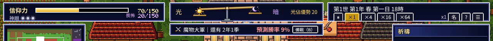

# 《輪迴之天秤》V4.1 試玩回饋與「每天都想玩」提案

> 版本：V4.1（2026-10-14）　試玩對象：HEAD `732d656`（V4 攻防＋評定會、V3.4 點陣精修）
> 試玩方式：
> - 中文版實機操作：開場 → 就任評定會 → 備戰畫面 → 第 1 次攻防 3 階段 → 戰後報告；以 ×4 連續跑 90 秒，觀察節奏與通知。
> - 30 局 × 2 種策略的無頭模擬（`test/v4_sim.js`）：「不介入」與「照建議介入」。
> - `story_check`、`reader_check`。
>
> 本文分兩部分：
> - **A 部**：給 Codex 的細部調整，可以直接做。
> - **B 部**：「讓玩家每天都想回來」的提案，需要 SEVEN 決定。

---

## 總評

V4 和 V3.4 一天就上線，完成度很高。
- **畫面**：建築放大後比例正確，半木造牆、夜晚窗光、懸崖都有 SFC 的味道。
- **攻防演出**：橫向的戰鬥畫面很像 FF，3 階段與戰後報告也都有。
- **目的感**：畫面上方常駐「下一場攻防」欄，評定會也會在開局出現，「我要守住下一場」的目的已經成立。

**主要問題不在功能，而在「數字和節奏」**：
- 預測勝率不可信。
- 攻防對認真的玩家太簡單，對不介入的玩家太難。
- 戰鬥中，Lv1 的神幫不了人類。
- 預設速度太慢。
- 一局打完就結束，沒有任何東西留到下一次。

最後一點直接關係到「每天都想玩」，所以在 B 部處理。

---

## A 部：試玩問題與細部調整（給 Codex，V4.1）

依優先順序排列。

### A1｜預測勝率不準，而且讓人絕望（最優先）
- **現象**：
  - 開局顯示「預測勝率 9%」，但模擬中「照建議介入」的第 1 次攻防**勝率是 97%**。
  - 實機中，我把第 1 次攻防提前，預測 12%，結果卻「勝利」。
  - 模擬的校準誤差：預測 30% 的實際勝率是 56%，預測 52% 的實際是 80%，**最大誤差 28 個百分點**（規格要求 ≤ 15）。
- **影響**：玩家一開始看到 9% 會以為必輸；看到 12% 卻贏了，之後就不再相信這個數字。整個「備戰讓勝率上升」的目的感就會崩掉。
- **修法**：
  1. **重新校準**：用模擬資料擬合 `winProb()`，讓「預測值」對上「實際戰鬥結果」。驗收：30 局 × 2 策略，每個區間的誤差都 ≤ 15 個百分點。
  2. **顯示兩個數字**：`若現在開戰 9%　→　照目前成長，屆時約 58%`。第二個數字用目前的成長速度推估。這樣開局不會絕望，玩家也知道「放著不管會怎樣」。
  3. **顏色**：< 30% 紅、30～60% 黃、> 60% 綠，並加上箭頭表示趨勢（已有 ▲）。

### A2｜戰鬥中，Lv1 的神幫不了人類
- **現象**：第 1 階段的選項只有「預知夢（Lv2 解鎖）」「旁觀」「幫魔物一把」。剛開局的玩家在**最重要的時刻只能看或幫敵人**。

  
- **修法**：
  - 每個階段從 Lv1 就至少要有**一個幫人類的選項**，用現有的神力和信仰支付，例如：
    - 前哨戰：神諭「布陣」。
    - 主戰：恩寵「加護 1 名冒險者」。
    - 決勝：試煉「激勵英雄」。
  - 神格解鎖的神技，作為**更強的版本**加入。
  - 每個選項顯示「勝率 +x%、花費」，讓玩家看到效果。

### A3｜攻防對認真的玩家太簡單
- **數據**（30 局，照建議介入）：

  | 攻防 | 第 1 次 | 第 2 次 | 巨龍 | 第 3 次 | 魔王 |
  | --- | --- | --- | --- | --- | --- |
  | 勝率 | 97% | 93% | 100% | 90% | 63% |
- **影響**：前 4 場幾乎必勝，緊張感只出現在最後一場，中段變成「例行公事」。
- **修法**：
  - 威脅值隨村莊發展**適度成長**（自適應）。
  - **目標勝率**（照建議介入）：大舉進攻 70～85%、巨龍 60～75%、魔王 55～70%。
  - 不介入：維持第 1 次約 50%、魔王 ≤ 10%（目前是 57% 與 0%，可以）。

### A4｜勇者太早出現
- **現象**：「劍士 Lv6＝勇者」，實機中**第 0.5 年就出現勇者**。神旨「讓勇者誕生」幾乎不用努力就完成；「勇者誕生」這個 S 級事件也太早用掉了。
- **修法**：
  - 勇者條件改為：Lv8 以上，並且「在攻防中活下來且得到稱號」或「得到神的恩寵 3 次以上」。
  - 目標是勇者在**第 3～6 年**出現。

### A5｜節奏：預設太慢，而且會一直卡在 ×1
- **現象**：
  - 預設速度是 ×1。以 ×1 計算，第 1 次攻防要等**約 20～30 分鐘**。
  - 發生重要事件時會自動降到 ×1（這點很好），但**不會恢復**。實機中，第 25 秒降到 ×1 之後就一直停在 ×1。
- **修法**：
  - 預設改為 **×4**。
  - 自動降速後，玩家關閉通知或過 5 秒，就**恢復原本的速度**。
  - 新增「⏭ 快轉到下一個重要事件」按鈕：以 ×64 跑到下一個 S/A 事件或預兆再停。

### A6｜祈禱堆積
- **現象**：放著不管 90 秒，祈禱累積了 13 件；約一半會過期。
- **修法**：
  - 祈禱欄只顯示最緊急的 3 件，加上「還有 n 件」。
  - 新增「依建議回應全部」的批次按鈕，並顯示總花費。
  - 祈禱的生成頻率降約 30%，把份額讓給更有分量的事件。

### A7｜開局畫面太暗
- 遊戲從清晨 6 點開始，畫面是暗的；加上教學的半透明遮罩，第一印象很陰沉。
- **修法**：開局改為上午 9 點。

### A8｜評定會畫面太空、資訊不足
- **現象**：神旨卡只有一行字，沒有寫獎勵、難度、怎麼判定；下半部大片空白；看不到雙方戰力。

  
- **修法**：
  - **神旨卡**：加上「神格經驗 +N」「難度 ★～★★★」「判定方式」「目前進度」。
  - **神勅**：顯示效果與花費，花不起的變灰。
  - **空白處**：放「上一期報告」（大事件 3 條）、「雙方戰力對照」（長條圖），以及下一場的兩個預測數字（A1）。

### A9｜戰後報告缺少「神做了什麼」
- **現象**：報告列出戰死、成長、戰利品，但沒有說神的行動產生了什麼效果。

  
- **修法**：加上幾行，例如：
  - 「你的備戰讓勝率 +18%」。
  - 「恩寵救下了尤娜」。
  - 「神格經驗 +12（Lv2 → 還差 8）」。
  - 「神旨進度：讓遺孤成為冒險者 1/1 ✔」。

  這是**成就感的直接來源**。

### A10｜其他小問題
- `story_check` 仍有 5/60 局 FAIL（多為重複率），沿用 V3.2 B-10 的處理。
- `test/facing.js` 在 Linux 環境啟動失敗，應同 `tut.js` 支援 `CHROME_PATH`。

### A 部驗收
| 指標 | 目標 |
| --- | --- |
| 預測校準誤差 | 每個區間 ≤ 15 個百分點 |
| 開局顯示的「屆時預估」 | 與照建議介入的實際勝率誤差 ≤ 15 個百分點 |
| 照建議介入的勝率 | 大舉進攻 70～85%、巨龍 60～75%、魔王 55～70% |
| 勇者出現年份 | 中位數在第 3～6 年 |
| Lv1 每個戰鬥階段 | 至少 1 個幫人類的選項 |
| 第 1 次攻防的實際等待時間（預設速度、不手動調速） | ≤ 8 分鐘 |
| 自動降速後 | 5 秒內恢復原速度 |

---

## B 部：讓玩家「每天都想回來」（提案，需要 SEVEN 決定）

### B0. 原則
本作是 **Steam 買斷的單機遊戲**，和手遊不同：
- **不做**：登入獎勵、體力、限時活動、「不來就吃虧」的設計。買斷制玩家很反感，也和「神」的主題不合。
- **要做**：
  1. 每次 15～30 分鐘就能玩出一段完整的結果。
  2. 結束時留一個「好想知道接下來怎樣」的鉤子。
  3. 有**跨局累積**的東西，讓下一局和這一局有關。

最後一點正好是本作的主題：**輪迴**。

### B1｜一次遊玩＝一章（自然的停止點與鉤子）〔小〕
- 每場攻防結束時自動存檔，並顯示「**本章落幕**」畫面：
  - 這段時間的 3 行摘要。
  - 下一場的**預兆預告**，例如：「北山傳來龍的咆哮……」「米蕾在夜裡磨劍。」
  - 「下次繼續」與「繼續玩」兩個按鈕。
- 以 ×4 速計，一章約 6～8 分鐘，一天玩 1～3 章剛好。

### B2｜神的書架（每一世都變成一本書）〔中〕
- 每一世結束，史官把它裝訂成**一本書**：書名自動生成（例：《守護者尤娜與北山之龍》）、封面圖、主角、關鍵的攻防結果。
- 標題畫面多一個「**書架**」：一排排已完成的書，可以重讀、匯出成文字。
- 這是本作的核心賣點（小說）的收藏化，也是最強的「再來一局」理由：**我想寫另一本不一樣的書**。

### B3｜魂的系譜（跨局轉生）〔中〕※ 最推薦
- 每一局中被神「眷顧」的靈魂，會記錄到**跨局的「魂之系譜」**。
- 開新局時，可以選 1～3 個靈魂**轉生到新世界**：
  - 帶著「前世的記憶」，例如上一世是戰死的守護者，這一世從小就怕火、卻嚮往盾。
  - 史官會寫「再會」與「前世回響」的章節。
- 系譜畫面像家譜樹：同一個靈魂在第 1 本書是農夫，第 2 本是勇者，第 3 本變成魔王。
- **這就是「輪迴之天秤」這個標題的兌現**，也是玩家對角色產生長期感情的地方。

### B4｜永續的神格與「天秤的試煉」〔中〕
- **跨局的神格**：
  - 每局得到的神格經驗累積到「**神殿**」。
  - 可解鎖：新的開局神旨、新的神勅、新的神（例：「黃昏之神」）、新的地圖變化（港町、雪國，作為後期內容）。
- **挑戰等級**：「**天秤的試煉 1～10**」。每升一級加一個條件，例如魔王提早 1 年、巨龍 2 隻、開局人口減半。
- 讓已經會玩的人有往上爬的目標（類似 Hades 的熱度系統）。

### B5｜今日的世界（每日種子）〔小〕
- 以**當天日期**為種子，產生一個「今日的世界」，附 1 個特殊條件，例如「豐年」「龍醒得早」「沒有教會」。
- 完全離線。只在本機記錄「今天的成績」和「曾經玩過的日子」，**錯過的日子沒有任何懲罰**。
- 給「今天只想玩 30 分鐘」的人一個明確的選擇。

### B6｜不在時的世界（可選，實驗性）〔中〕
- 打開存檔時，史官先報告「**神沉睡的期間**」：世界依真實經過的時間，推進最多 1 季。
  - 不會跨過攻防。
  - 眷顧者不會死亡。
- 同時收到眷顧者的「**祈禱信**」，例如：「神啊，我的孩子今天會走路了。」
- 有「打開看看我的子民怎麼了」的電子雞效果；但有人會覺得失去控制，所以**預設關閉**，可在設定中開啟。

### B7｜收藏〔小〜中〕
- **傳說**（成就）約 60 個：第一位屠龍者、龍之盟約、人魔之友、轉生重逢……
- **名人堂**：跨局保存的有名人物（英雄、魔物幹部、史官）。
- **魔物圖鑑**。

### B 部的建議順序
1. **先做 B1（章節落幕）＋ B3（魂的系譜）＋ B2（書架）**：最貼近本作主題，投資報酬最高。
2. 再做 B4（永續神格與挑戰）、B5（今日的世界）。
3. B6 作為實驗功能，視試玩反應決定。

---

## 需要你決定的事

1. **A 部全部交給 Codex 做（V4.1）**，可以嗎？
2. **B 部的方向**：「不做登入獎勵等手遊式設計，用章節落幕＋跨局輪迴＋書架讓玩家回來」，同意嗎？
3. **B 部先做哪些**：建議 B1＋B2＋B3。
4. **B6「不在時的世界」**：要做成可選功能嗎？
