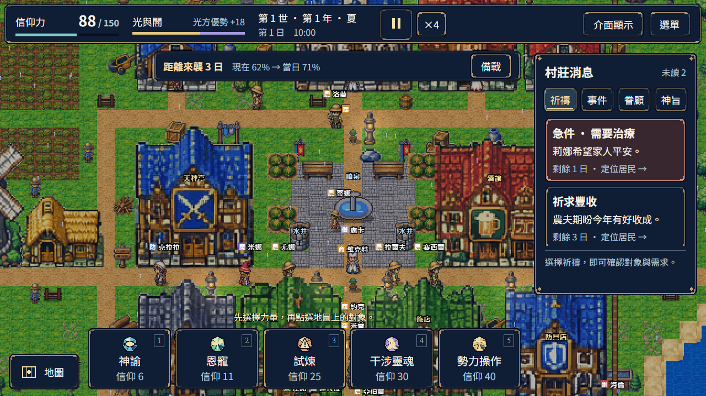
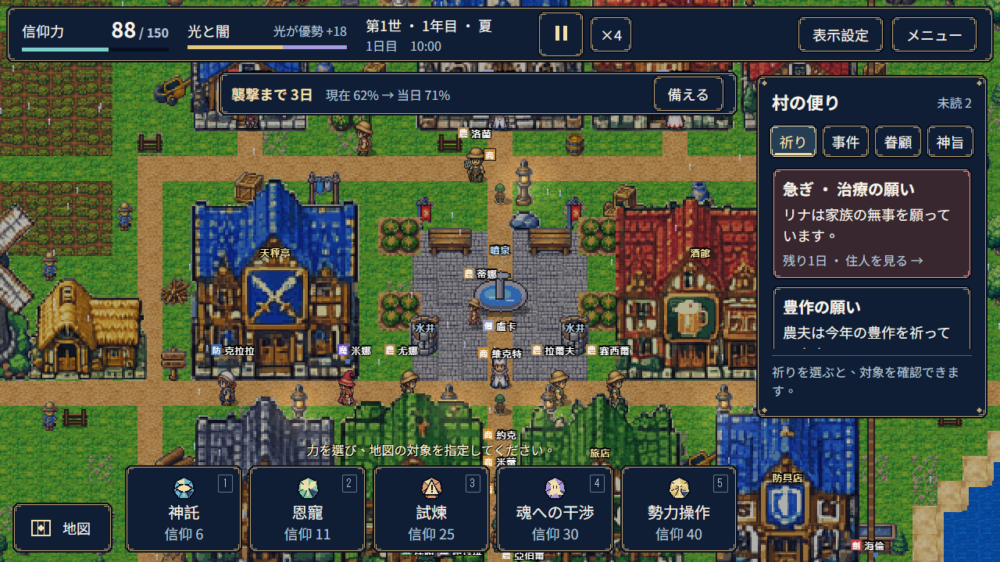
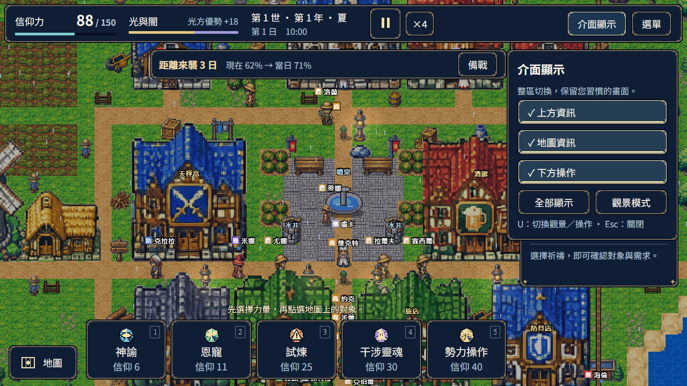
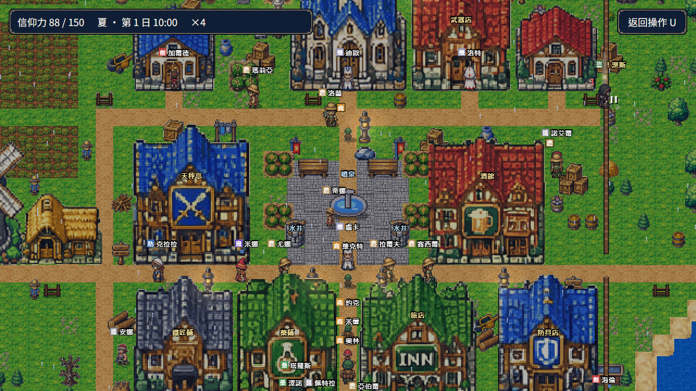
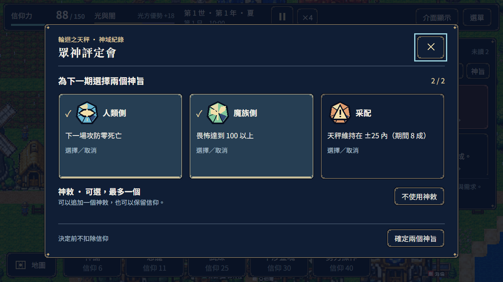
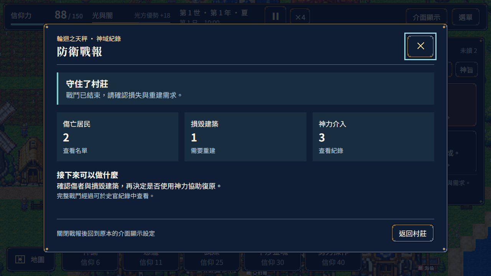

# 遊戲中 UI v5 交付

SEVEN 確認方向：重新設計外觀；上方、地圖資訊、下方整區顯示控制；全開／觀景。不保留逐小面板關閉鈕。

1. [程式接入指示書](implementation.md)
2. [85 張 PNG 清單](../../assets/design/ui_v5/manifest.md)
3. [互動預覽](preview.html)（下載專案後以瀏覽器開啟）
4. [檢查紀錄](validation.json)

數據與背景只用於外觀驗收。本次提供素材與實作規格，尚未替換遊戲內的 UI。
