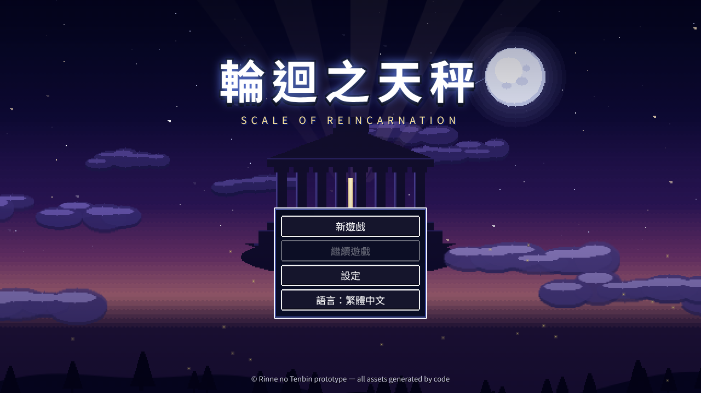
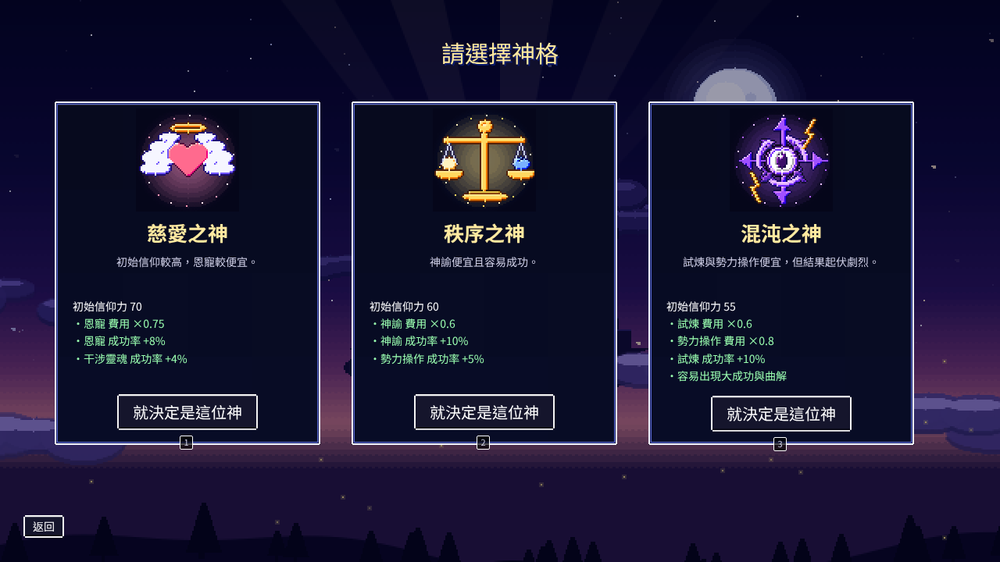
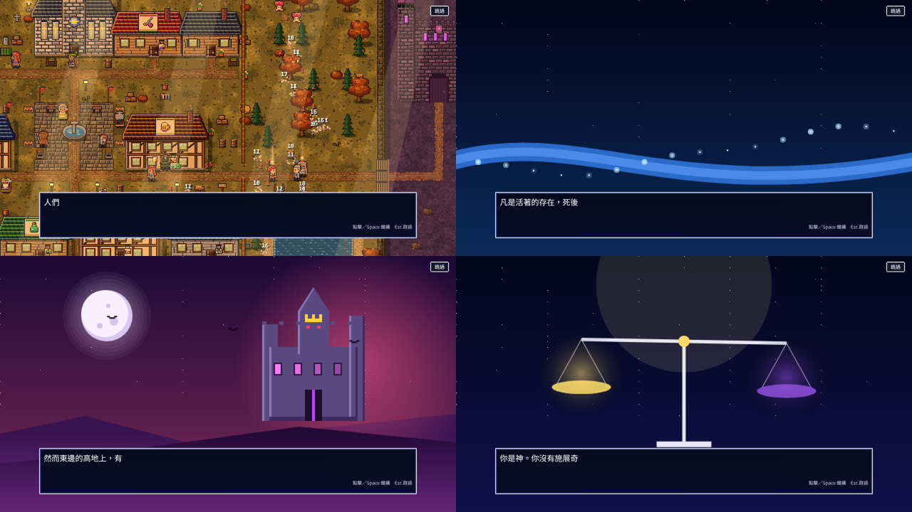

# 《輪迴之天秤／輪廻の天秤》開頭畫面 設計指示書（設計部用）

> 版本：2026-10-14　撰寫：Claude（SEVEN 指示）　對象：設計部
> 本文件有兩部分：
> - **第 1 部：玩法簡介**：給設計師理解這款遊戲。
> - **第 2 部：要設計的畫面清單與規格**。
>
> **設計想法請自由發揮。** 本文件只規定「這個畫面要讓玩家做什麼、一定要有哪些元素、技術限制」。風格、構圖、配色、象徵都交給設計部。

---

## 第 1 部　玩法簡介

### 一句話
**你是神，但不是萬能的神。** 你只能聆聽村民的祈禱，用一點點信仰力，悄悄推動他們的人生。等十年後魔王來臨時，看看這個村莊能不能自己站起來。

### 世界
- 這個世界有一座**天秤**，光與暗在上面分擔彼此的重量。
- 舞台是一個小鎮：**琉米耶鎮（リュミエの町）**。大約 36 位村民在這裡烤麵包、磨劍、談戀愛、吵架、變老、死去。
- 人死後，靈魂會順著**靈魂之河**而下，依「因果的重量」**轉生**成新的生命。
- 東邊的高地上有一把**魔王之席**。當黑暗盈滿，就會有人坐上去。

### 玩家要做什麼
1. **聆聽祈禱**：村民頭上會冒出祈禱：生病、飢餓、戀愛、復仇、害怕……。神要選擇聽哪一個。
2. **用信仰力回應**：神有 4 種力量。
   - **恩寵**：直接幫忙，例如治病、豐收。
   - **神諭**：給一句提示，人們會怎麼理解就不一定了。
   - **試煉**：讓人遇到困難，因而成長。
   - **勢力操作**：推動光或暗那一邊。
   回應得好，村民更信神，神的力量也會變大。
3. **看著他們自己活**：神不能直接命令任何人。村民有自己的個性、職業、戀愛與仇恨，會自己做選擇。
   - 職業有：劍士、魔法師、僧侶、盜賊、農夫、商人、鐵匠、藥師、史官、武器商人、防具商人。
4. **準備迎戰魔王軍**：一個時代是 10 年。
   - 魔王軍會分 5 次來襲：第 2～3 年、第 4 年、第 5 年的巨龍、第 7 年左右，最後是第 10 年的魔王。
   - 神要讓村莊變強：培養冒險者、等待**勇者**誕生、在評定會下達政策。
   - 之後的版本可以派勇者**主動遠征魔王城**。
5. **人生會變成一本書**：村裡發生的每件事，都會由遊戲自動寫成**編年史（小說）**。誰愛上誰、誰為誰而死、誰轉生成誰，全都會留下來。
6. **輪迴**：一個時代結束後，進入下一世。前世的靈魂帶著因果轉生，故事繼續。

### 選擇神格（開局）
開局時玩家選一位神。三位神的玩法不同：

| 神 | 個性 | 玩法特色 |
| --- | --- | --- |
| 慈愛之神 | 溫柔、守護 | 恩寵便宜，初始信仰力最高 |
| 秩序之神 | 公正、天秤 | 神諭便宜、容易成功 |
| 混沌之神 | 狂野、變化 | 試煉與勢力操作便宜，但結果起伏很大 |

### 氣氛關鍵字（給設計的參考，不是限制）
- **溫暖而略帶憂傷**：日常很可愛，但人會老、會死、會轉生。
- **神的距離感**：神在高處看著，只能「聽」和「輕推」。
- **天秤、光與暗、靈魂之河、祈禱、書與編年史、東方高地的魔王之席**。
- 遊戲本體是 **16bit 點陣風**（類似 SFC 時代的 RPG）。
- 對象包含**小學生**，要看得懂、不可怕到讓小孩不敢玩（魔王可以威嚴，但不要血腥恐怖）。

### 基本資訊
- 平台：Steam（PC），買斷制，單機。
- 語言：**日文、繁體中文**（兩種都要有標題 Logo）。
- 遊戲畫面：**1280×720**（16:9，可放大到全螢幕）。

---

## 第 2 部　進入遊戲前的畫面

### 畫面流程

```
① 開發商 Logo（新增，可選）
   ↓
② 啟動畫面「點擊開始」
   ↓
③ 標題畫面 ──→ ④ 讀取存檔（繼續遊戲）
   │       └──→ ⑤ 設定
   ↓ 新遊戲
⑥ 模式選擇（新增：普通／簡單模式）
   ↓
⑦ 神格選擇（3 選 1）
   ↓
⑧ 開場劇情（5 頁）
   ↓
進入遊戲（教學開始）
```

目前遊戲的樣子（全部由程式畫的暫定版，**僅供了解畫面用途，不用參考風格**）：

| 標題 | 神格選擇 | 開場劇情 |
| --- | --- | --- |
|  |  |  |

### 共通規格

| 項目 | 規格 |
| --- | --- |
| 畫面大小 | 1280×720 |
| 交付解析度 | 點陣風：用 **640×360 原寸**畫（遊戲放大 2 倍顯示，像素才會清楚）。插畫風：交 **2560×1440** |
| 風格 | **自由**：點陣、插畫、混合都可以。但要能和 16bit 點陣的遊戲本體自然銜接 |
| 文字 | **選單文字、說明文字不要畫進圖裡**，由遊戲程式顯示（因為要切換日文和中文）。**只有 Logo 是圖** |
| 格式 | PNG（透明背景用 PNG-32）；可以附 PSD 原檔 |
| 分層 | 背景想做動態效果（視差捲動、雲在飄、星星閃）時，請**分層交付**：天空、遠景、中景、近景、前景特效各一張 |
| 動畫 | 可以提案（例：光點、水流、天秤搖晃）。請用「分層＋文字說明」或幾張關鍵幀交付，由程式實作 |
| 色數 | 點陣風建議 32～64 色，和遊戲本體一致 |

---

### ① 開發商 Logo（新增，可選）
- **目的**：顯示開發或發行商 Logo。
- **必要元素**：公司 Logo（請 SEVEN 確認要放哪一家）。
- **長度**：約 2 秒，可跳過。
- **自由**：背景、出現方式。

### ② 啟動畫面「點擊開始」
- **目的**：網頁版瀏覽器規定「要點一下才能播放聲音」，所以需要這個畫面。Steam 版也可以保留，當成「Press Any Key」。
- **必要元素**：一行提示文字（程式顯示：「點擊或按下任意鍵開始」）。
- **自由**：可以是全黑、標題背景的預覽，或一個小小的天秤圖示。也可以和標題畫面**合併**（設計部提案）。

### ③ 標題畫面（**最重要**）
- **目的**：遊戲的門面，也會用在 Steam 截圖與宣傳。
- **必要元素**：
  1. **標題 Logo 兩種語言**：日文「輪廻の天秤」、繁中「輪迴之天秤」。
  2. 英文副標（Logo 的一部分或另外排）。目前用「RINNE NO TENBIN／SCALE OF REINCARNATION」，可以重新提案。
  3. **選單區**，4 個項目，由程式顯示：新遊戲／繼續遊戲／設定／語言。
     - 請在背景上**留出放選單的位置**，並設計選單的外框和按鈕樣式。
     - 要有一般、滑鼠移上去、按下、不能按（例如沒有存檔時的「繼續遊戲」）4 種狀態。
  4. 版權列（底部一行小字，由程式顯示）。
- **自由**：主視覺。可以把「第 1 部」的任何元素當主題：天秤、神的視角、村莊、靈魂之河、魔王之席……
- **交付**：
  - Logo 日文、繁中各 1 張，透明 PNG，另附 SVG 或 AI。
  - 背景（可分層）。
  - 選單外框與按鈕 4 種狀態。

### ④ 讀取存檔（繼續遊戲）
- **目的**：選擇要讀取的存檔。共 **4 格**。
- **每格顯示的資訊**（文字由程式顯示）：第幾世、第幾年、季節、神格、遊玩時間、存檔日期。
  - 可以加一張小圖示，例如神格的紋章。
- **自由**：存檔格的外觀（例：書本、卷軸、天秤的盤子……）。
- **交付**：存檔格的外框（有存檔、空格、選中 3 種狀態）、背景。

### ⑤ 設定
- **目的**：調整語言、音量、遊戲速度、文字速度等。
- **必要元素**：視窗外框、分頁標籤、開關（ON／OFF）、滑桿。
- **自由**：外觀。**建議和遊戲中的視窗共用同一套 UI 外框**，這套外框之後也會用在遊戲內。

### ⑥ 模式選擇（新增）
- **目的**：第一次玩的人（包含小學生）可以選「簡單模式」。
- **必要元素**：2 個選項。
  - **普通**：標準體驗。
  - **簡單**：信仰力比較多、魔王軍比較弱、提示比較多。第一次玩時要標「推薦」。
  - 選項文字和說明文字都由程式顯示。
- **自由**：外觀（例：兩個盤子大小不同的天秤、兩扇門……）。
- **交付**：2 張選項卡（一般、選中狀態）、「推薦」標記、背景。

### ⑦ 神格選擇（3 選 1）
- **目的**：選擇本局要當哪一位神。
- **必要元素**：
  1. **3 位神的紋章（或形象）**：慈愛之神、秩序之神、混沌之神。個性見第 1 部的表。
  2. 每位神一張卡片。卡片上的文字由程式顯示：神名、一句說明、初始信仰力、3～4 行特色。
  3. 「就決定是這位神」按鈕、返回按鈕。
- **自由**：
  - 神要畫成「紋章」還是「人物」都可以。
  - 只是要注意：**遊戲中神不會以人物的樣子出現**（玩家就是神）。畫人物的話，請保持神秘感（例：剪影、光、背影）。
- **交付**：3 個紋章或形象（遊戲中的 HUD 也會用到縮小版，**請另交 64×64 和 32×32**）、卡片外框（一般、選中）、背景。

### ⑧ 開場劇情（5 頁）
- **目的**：用 5 張圖加文字，介紹世界觀。可以跳過。
- **文字**（由程式逐字顯示在畫面**下方的文字框**，請在圖的**下方約 1/4 留空**或留暗）：

| 頁 | 文字（繁中） | 畫面內容（建議，可自由詮釋） |
| --- | --- | --- |
| 1 | 這個世界有一座天秤。光與暗在上面分擔彼此的重量。 | 天秤、光與暗 |
| 2 | 人們祈禱，神傾聽。琉米耶鎮今天也一樣，人們烤著麵包、磨著劍，為某個人祈求平安。 | 村莊的日常 |
| 3 | 凡是活著的存在，死後都會順著靈魂之河而下，依因果的重量，再度轉生。 | 靈魂之河、轉生 |
| 4 | 然而東邊的高地上，有一把魔王之席。當黑暗盈滿，就會有人坐上去。 | 魔王之席、魔王城 |
| 5 | 你是神。你沒有施展奇蹟的力量，也沒有拯救世界的劍。你擁有的，只有聆聽祈禱的耳朵，與微薄的信仰力。 | 神的視角，俯瞰村莊 |

（日文版文字由程式切換；圖要兩種語言都能用，所以**圖裡不要有文字**。）
- **自由**：構圖、一頁一張圖，或做成一張連續的長圖（用捲動的方式呈現）。
- **交付**：5 張圖（可分層）；文字框外框（可和 ⑤ 共用）。
- **注意**：第 5 頁之後會直接進入遊戲畫面（俯瞰村莊）。第 5 頁若能自然**過渡到遊戲畫面**（例：鏡頭往下拉到村莊）會很好。

---

### 一併提案（可選）
- **UI 外框一套**：③～⑧ 共用的視窗外框、按鈕、文字框。之後會沿用到遊戲內的所有視窗。
- **Steam 素材**：主視覺若可以延伸成 Steam 商店的封面圖（各種尺寸），請在構圖時就考慮裁切。

### 不在本次範圍
- 遊戲內的角色、建築、魔物點陣：已有設計圖，另外處理。
- 遊戲內的 HUD 介面：之後再說。

### 流程
1. 設計部先交**草圖**（③ 標題的 2～3 個方向、⑦ 神紋章的草稿）。
2. Claude 檢查是否符合玩法與技術限制（文字有沒有畫進圖、要留的空間、尺寸）。
3. SEVEN 決定方向。
4. 設計部完稿 → 交給程式（Codex）實作 → SEVEN 驗收。

### 交付清單（總表）

| # | 畫面 | 交付物 | 優先度 |
| --- | --- | --- | --- |
| ③ | 標題 | Logo（日、中）＋背景（分層）＋選單按鈕 4 狀態 | ★★★ |
| ⑦ | 神格選擇 | 3 神紋章（大、64、32）＋卡片外框＋背景 | ★★★ |
| ⑧ | 開場劇情 | 5 張圖 | ★★ |
| ⑥ | 模式選擇 | 選項卡＋推薦標記＋背景 | ★★ |
| ④ | 讀取存檔 | 存檔格 3 狀態＋背景 | ★ |
| ⑤ | 設定 | UI 外框、開關、滑桿 | ★ |
| ② | 啟動 | 背景（或和 ③ 合併） | ★ |
| ① | 開發商 Logo | 公司 Logo 畫面 | 可選 |
